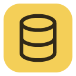
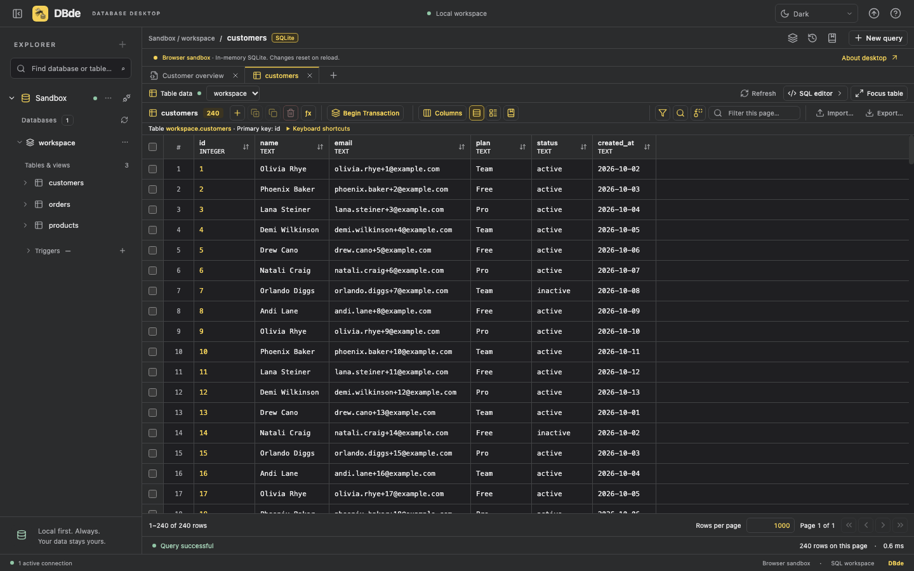
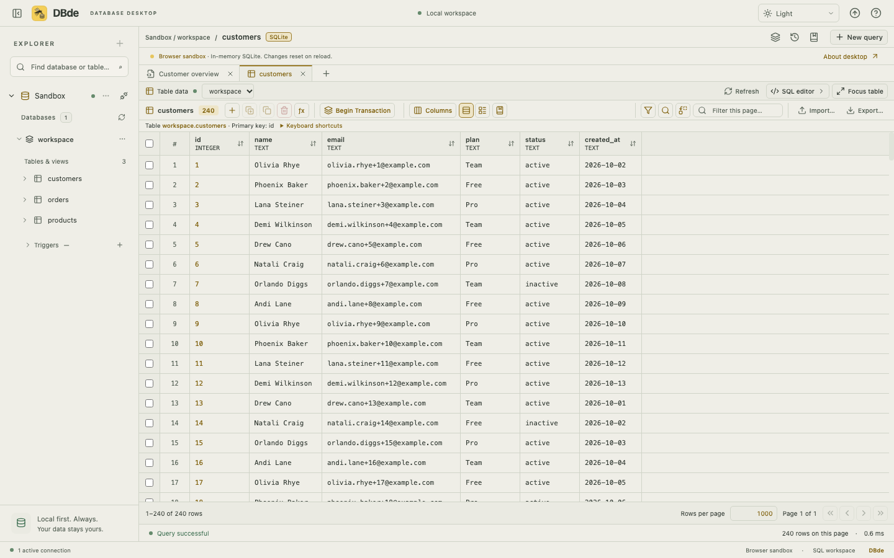
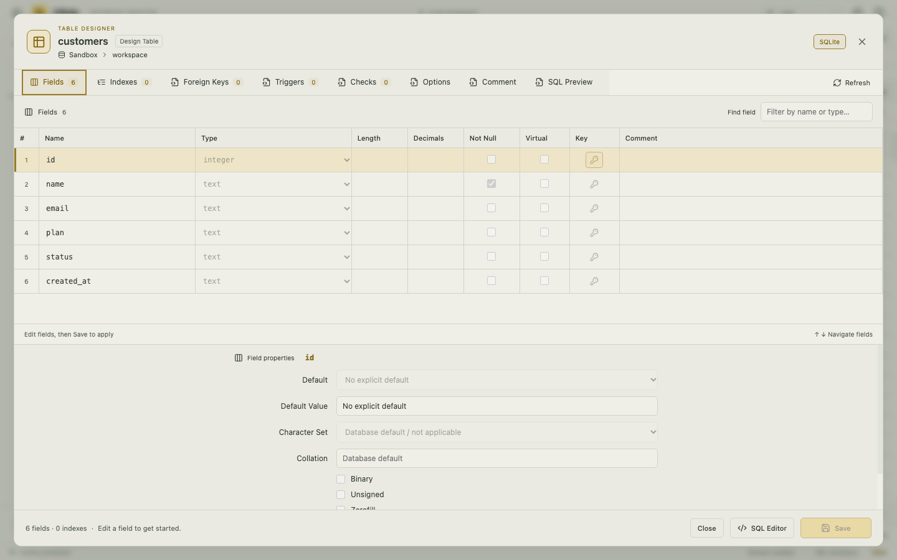
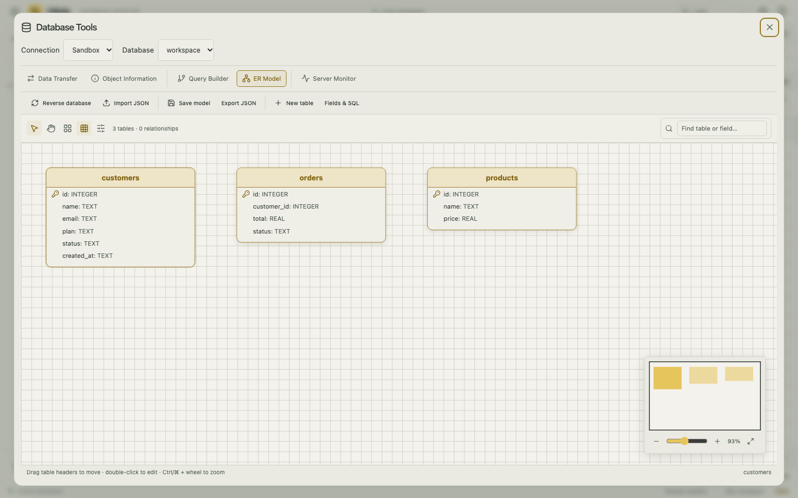

<p align="center">
  
</p>

# DBde

**Aplikasi desktop untuk menjelajahi database, menjalankan SQL, dan mengedit data dalam satu workspace.**

DBde mendukung **MySQL/MariaDB, PostgreSQL, dan SQLite**. Koneksi berjalan langsung dari perangkat Anda. Aplikasi dibangun dengan Tauri, Rust, React, dan TypeScript.

[Mulai menjalankan](#mulai-menjalankan) · [Screenshot](#screenshot) · [Kontribusi](CONTRIBUTING.md) · [Panduan penggunaan](docs/USER_GUIDE.md) · [Rilis dan update](docs/RELEASING.md)



> Screenshot menggunakan data contoh dari SQLite sandbox. Koneksi ke database lokal atau server tersedia melalui aplikasi desktop.

## Yang bisa dilakukan

| Bagian         | Fitur                                                                                                      |
| -------------- | ---------------------------------------------------------------------------------------------------------- |
| Koneksi        | Banyak koneksi, profil tersimpan, SSL, SSH tunnel, dan pilihan database yang ditampilkan.                  |
| Explorer       | Cari database/tabel, menu klik kanan, daftar tabel, dan sidebar yang lebarnya bisa digeser.                |
| Tabel          | Edit sel, tambah/hapus record, copy/paste, seleksi dengan mouse/keyboard, dan validasi tipe data.          |
| Pencarian      | Filter AND/OR, sort, find/replace pada halaman tabel, dan pagination dengan jumlah baris yang bisa diatur. |
| SQL            | Editor SQL, autocomplete, format SQL, query history, saved queries, dan Explain.                           |
| Struktur       | Buat tabel dan tinjau/edit definisi field melalui Design Table, sesuai dukungan database.                  |
| Database tools | Transfer record, informasi objek, server monitor, visual SELECT builder, dan ER Model.                     |
| File           | Import CSV/TSV/Excel; export CSV/TSV/JSON/Excel/SQL sesuai alur yang dipilih.                              |
| Workspace      | Tab yang bisa dipindah, jendela khusus tabel, tema gelap/terang/otomatis, dan table profiles.              |
| Update         | Pemeriksaan versi dari GitHub Releases dan pemasangan update bertanda tangan.                              |

Fitur tertentu memerlukan primary key, izin akun database, atau dukungan engine. Lihat [panduan penggunaan dan batasan](docs/USER_GUIDE.md).

## Mulai menjalankan

### 1. Siapkan perangkat

Untuk menjalankan **source code**, siapkan:

- **Git** untuk mengambil repository.
- **Node.js 22.12 atau lebih baru** beserta npm.
- **Rust stable** melalui [rustup](https://rustup.rs/) untuk aplikasi desktop.
- Dependency sistem sesuai [prasyarat Tauri](https://v2.tauri.app/start/prerequisites/).

Di macOS, pasang Xcode Command Line Tools jika belum tersedia:

```bash
xcode-select --install
```

Jika muncul pesan **already installed**, lanjut ke langkah berikutnya. Windows memerlukan MSVC/WebView2; Linux memerlukan WebKitGTK dan library build/Secret Service. Ikuti panduan Tauri untuk OS masing-masing.

### 2. Ambil proyek dan pasang dependency

```bash
git clone https://github.com/adeJN/dbde.git
cd dbde
npm ci
```

### 3. Pilih cara menjalankan

**Aplikasi desktop — untuk database Anda sendiri:**

```bash
npm run tauri dev
```

Perintah ini menjalankan Vite dan membuka jendela aplikasi secara otomatis. Build Rust pertama bisa lebih lama karena perlu mengunduh dan mengompilasi dependency.

**Browser sandbox — untuk mencoba UI tanpa Rust dan tanpa database:**

```bash
npm run dev
```

Buka **http://127.0.0.1:1420**, lalu klik **Explore the sandbox**. Data contoh hanya tersimpan sementara dan kembali ke awal saat halaman dimuat ulang. Browser sandbox tidak bisa menghubungkan MySQL/PostgreSQL eksternal.

> Pilih salah satu cara di atas. Jangan menjalankan `npm run dev` terpisah bersamaan dengan `npm run tauri dev`, karena keduanya memakai port 1420.

## Hubungkan database pertama

1. Buka aplikasi desktop dan klik **New connection** atau tombol **+** di Explorer.
2. Pilih MySQL, PostgreSQL, atau SQLite.
3. Isi host, port, username, dan password; untuk SQLite pilih path file.
4. Klik **Test connection**, lalu **Connect database**.
5. Klik nama database untuk melihat daftar tabel; buka tabel untuk melihat datanya.

Contoh **MySQL/MariaDB lokal**: host `127.0.0.1`, port `3306`, username sesuai server Anda. Jika akun memang tidak memiliki password, biarkan kolom Password kosong. Gunakan SSL **Disable** hanya untuk server lokal yang tidak menyediakan TLS.

Database awal boleh kosong untuk menampilkan database yang dapat diakses akun. Tab **Databases** menyediakan daftar khusus jika hanya beberapa database yang ingin ditampilkan.

## Screenshot

Screenshot berikut diambil dari aplikasi yang berjalan, menggunakan data demo dan tanpa kredensial pribadi.

### Mode terang



### Design Table



### ER Model



## Shortcut dasar

Shortcut mengikuti area yang sedang aktif. Klik ikon **? / Help** di kanan atas untuk melihat daftar lengkapnya.

| Aksi                                            | macOS                             | Windows/Linux                     |
| ----------------------------------------------- | --------------------------------- | --------------------------------- |
| Jalankan SQL di editor                          | `⌘ Enter`                         | `Ctrl Enter`                      |
| Buka Design Table dari tabel aktif/daftar tabel | `⌘ D`                             | `Ctrl D`                          |
| Cari pada tabel/editor aktif                    | `⌘ F`                             | `Ctrl F`                          |
| Navigasi sel                                    | Tombol panah / `Tab`              | Tombol panah / `Tab`              |
| Edit sel                                        | `Enter`, `F2`, atau klik dua kali | `Enter`, `F2`, atau klik dua kali |
| Copy/paste seleksi                              | `⌘ C` / `⌘ V`                     | `Ctrl C` / `Ctrl V`               |

## Untuk kolaborator

Mulai dari [CONTRIBUTING.md](CONTRIBUTING.md): alur branch dan pull request, struktur folder, pemeriksaan sebelum PR, serta cara menambahkan screenshot.

Pemeriksaan utama dari root repository:

```bash
npm test
npm run build
cargo test --manifest-path src-tauri/Cargo.toml --locked
```

Untuk pemeriksaan tambahan dan tes integrasi, ikuti [panduan kontribusi](CONTRIBUTING.md#pemeriksaan-sebelum-pull-request).

## Installer dan update

- Pengguna installer tidak perlu memasang Node.js atau Rust. Unduh installer yang sesuai perangkat melalui [GitHub Releases](https://github.com/adeJN/dbde/releases) setelah tersedia.
- **Push kode bukan publikasi installer.** Updater memerlukan Release beserta arsip update, tanda tangan, dan `latest.json`.
- Ikon panah naik di sebelah Help membuka **App updates**. Tombol ditandai kuning saat versi baru tersedia.
- Jika belum ada informasi rilis, aplikasi menampilkan **Update information is not available yet**.
- Pengguna build lama sebelum updater perlu memasang build yang mendukung updater satu kali secara manual.

Cara membuat installer dan mempublikasikan update: [docs/RELEASING.md](docs/RELEASING.md). Private key updater hanya diperlukan oleh maintainer rilis, bukan kolaborator biasa.

## Kendala yang sering ditemui

| Kendala                                         | Langkah awal                                                                                                   |
| ----------------------------------------------- | -------------------------------------------------------------------------------------------------------------- |
| `Port 1420 is already in use`                   | Hentikan server dev lama dengan `Ctrl+C`, lalu jalankan satu perintah dev saja.                                |
| MySQL `Access denied`                           | Periksa akun, password, host, port, dan izin koneksi di server. Untuk akun tanpa password, kosongkan Password. |
| Aplikasi macOS disebut damaged/cannot be opened | Periksa asal installer dan signing/notarization-nya. Maintainer perlu mengikuti panduan rilis macOS.           |
| Update belum tersedia                           | Pastikan GitHub Release dan `latest.json` sudah dipublikasikan; push source code saja belum cukup.             |
| Folder proyek membesar setelah build            | Cache Rust berada di `src-tauri/target`. Lihat panduan pembersihan pada CONTRIBUTING.                          |

Untuk melaporkan masalah, buat [GitHub Issue](https://github.com/adeJN/dbde/issues) dengan langkah reproduksi, versi aplikasi/OS, dan pesan error. Jangan sertakan password, token, private key, atau data produksi.
